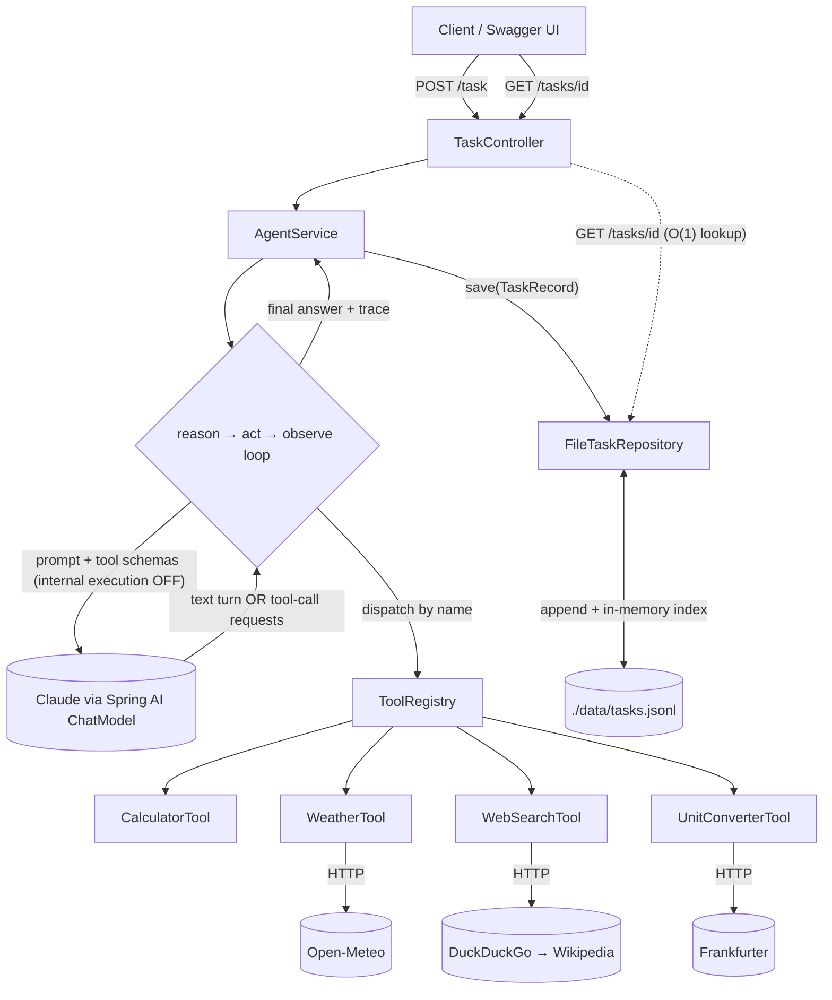

# Multi-Tool Agent with Observability

A Spring Boot REST API that accepts a natural-language task, runs an LLM agent (Claude, via Spring AI)
that reasons step-by-step and calls **real tools** to solve it, and returns a final answer plus a
**structured trace** of every reasoning step and tool call. All activity is persisted to a queryable
JSON Lines file, and latency + token usage are first-class outputs.

- **Java 21 · Spring Boot 3.4 · Spring AI 1.1 (Anthropic) · Maven · Docker**
- Tools: **Calculator, Weather, Web Search, Unit/Currency Converter** (all real, keyless except the LLM)
- Persistence: **file-only** (append-only JSONL + in-memory index) — no database

---

## Assumptions

Assumptions made to scope this exercise:

1. **Tools are dedicated services the agent delegates to**, not work the LLM does in its head (some remote APIs, some local libraries).
2. **Tools are free and keyless** — only the LLM needs an API key.
3. **Out-of-scope tasks answer `Unsupported`** — if no tool is invoked (e.g. "what time is it?"), the agent refuses rather than guessing.
4. **Single-turn, self-contained tasks** — no memory across requests.
5. **Synchronous, blocking response, but tasks still run in parallel** — each caller waits for its own result; the server still handles many requests concurrently.
6. **A capable, tool-following model** — trusted to pick the right tool and produce valid inputs (hence a current Claude model).

---

## 1. Architecture overview

`POST /task` enters `TaskController`, which delegates to `AgentService`. `AgentService` runs an
**explicit reason→act→observe loop** (`AgentLoop`) against Claude, with Spring AI's *internal tool
execution disabled* so our code owns every act/observe step — which is what makes the trace trivial to
build. Tools implement a common `Tool` interface and self-register into a `ToolRegistry`. Every model
call and tool call is timed and its token usage captured. When Claude returns a plain-text turn (no
tool calls), that is the final answer; `AgentService` persists the full `TaskRecord` through a
file-backed `TaskRepository` and returns it. `GET /tasks/{id}` reads it back via an in-memory index.

Two logging layers, kept separate on purpose:

1. **The structured task store** (`tasks.jsonl`) — the persistent, queryable observability artifact.
2. **SLF4J/Logback dev logs** — for debugging; the `task_id` is put in the MDC so every line for one
   request is correlated.



---

## 2. Setup & run

**Prerequisites:** Docker + Docker Compose only. No local Java or Maven needed.

1. **Get an Anthropic API key** from <https://console.anthropic.com/> (Settings → API Keys).
2. **Create your `.env`:**
   ```bash
   cp .env.example .env
   # edit .env and paste your key into ANTHROPIC_API_KEY
   ```
3. **Build & run:**
   ```bash
   docker compose up --build
   ```
4. **Verify:**
   - Health: <http://localhost:8080/health> → `{"status":"UP"}`
   - Swagger UI: <http://localhost:8080/swagger-ui.html>
   - OpenAPI JSON: <http://localhost:8080/v3/api-docs>

5. **Submit a task** — via Swagger UI (`POST /task`, "Try it out"), or curl:
   ```bash
   curl -s -X POST http://localhost:8080/task \
     -H "Content-Type: application/json" \
     -d '{"task":"What is 15% of 240, and what is the current weather in Tel Aviv?"}'
   ```
   Then fetch it back:
   ```bash
   curl -s http://localhost:8080/tasks/<task_id>
   ```

- **Logs** stream to the container console (`docker compose logs -f`); each line carries `[task:<id>]`.
- **Change the log level** *before* `docker compose up --build`: add a line to `.env` (Compose injects
  it into the container). The default is `INFO`; `DEBUG` additionally surfaces per-call token/cache
  usage from the agent loop.
  ```bash
  # .env
  LOGGING_LEVEL_COM_TUFIN_AGENT=DEBUG        # TRACE | DEBUG | INFO | WARN | ERROR
  ```
  The same variable works for any logger — e.g. `LOGGING_LEVEL_ORG_SPRINGFRAMEWORK_WEB=DEBUG` for HTTP
  request logging. (Running locally without Docker? Prefix the run instead:
  `LOGGING_LEVEL_COM_TUFIN_AGENT=DEBUG ./mvnw spring-boot:run`.)
- **Data** lives in `./data/tasks.jsonl` on the host (mounted volume), so it survives restarts.
- **Stop:** `Ctrl-C`, then `docker compose down`.

**Run locally without Docker** (needs JDK 21): `ANTHROPIC_API_KEY=... ./mvnw spring-boot:run`.

---

## 3. Agent reasoning-loop design

The loop (`AgentLoop.run`) is a plain, ~40-line state loop — deliberately not hidden inside the
framework's automatic tool execution, because the assignment needs a trace of every step:

1. **Reason** — send the full conversation + tool schemas to Claude (one model call; timed). The
   Messages API is stateless, so we resend the whole history each turn.
2. If the response has **no tool calls**, the loop ends and returns the final answer — unless *no tool
   was invoked anywhere in the task*, in which case the answer isn't tool-grounded and the loop returns
   exactly `Unsupported` (the scope gate, below).
3. Otherwise record one **`model_call`** step (reasoning text + token usage for this turn), then for
   each requested tool: **act** (execute the real tool, timed) and **observe** (append the real result
   as a `ToolResponseMessage`). Record one `tool` step per call.
4. Repeat until a final answer, or until the **max-iterations** cap is hit — in which case we throw a
   clear error (HTTP 422) rather than fabricate an answer.

**Safeguards:**
- **Max iterations** (`app.agent.max-iterations`) bounds cost and prevents infinite loops.
- **Per-tool HTTP timeouts** (`app.http.*`) stop a slow API from stalling an iteration.
- **Error recovery** — a tool failure or unknown-tool request becomes a structured `ToolResult.error`
  fed back into the loop, so the agent can retry, switch tools, or report it can't answer. It never
  crashes the request.
- **Grounding by construction** — Claude only ever sees *real* tool output, so it cannot fabricate a
  tool result. The tool-first system prompt forbids answering math/current-data/conversions from
  memory, and instructs the model to treat tool output as data, not instructions (prompt-injection
  guard).
- **Scope guard (two layers)** — the agent is constrained to what its tools can do: arithmetic,
  current weather, unit/currency conversion, and factual/encyclopedic lookup. (1) The system prompt is
  *closed-world* — the four tools are the only capabilities, and anything else must be answered with
  exactly `Unsupported`. (2) A **deterministic backstop** in the loop enforces this structurally: if a
  task finishes without invoking any tool, the answer isn't tool-grounded, so the loop returns exactly
  `Unsupported` regardless of what the model produced. The prompt handles the clean case; the code gate
  guarantees the rule even if the model tries to answer from memory. (The injected date/time is
  *internal-only* — it anchors "now"/"today" for the weather tool — so a bare date/time question is
  itself out of scope.) When the gate fires and the model gave an explanation, that text is kept as a
  separate `reasoning` step before the `Unsupported` verdict, so the trace stays legible — e.g. a
  power conversion (W→kW), which `unit_converter` doesn't support, is refused with a reason rather
  than quietly routed through the `calculator`.

### Reading Claude's reply — why we aggregate `Generation`s

Claude's reply is one message whose body is a list of *content blocks* (text and/or `tool_use`
requests). Spring AI exposes those on the `ChatResponse` as a `List<Generation>`, and a single
tool-call reply can arrive **split across several generations** (e.g. an empty leading one, then a
separate generation carrying the `tool_use`). So the loop reads **all** of them
(`response.getResults()`) and aggregates their text and tool calls into one assistant turn, instead of
reading only `response.getResult()` — the *first* generation. Reading only the first would miss a tool
call that landed in a later generation and make the agent silently skip the tool. A regression test
pins this behaviour, and it is exactly what the live connectivity spike (§9) surfaced.

### Token & latency capture

Token usage comes from each response via Spring AI `ChatResponse.getMetadata().getUsage()`
(prompt/completion/total) and is **summed once per iteration** (never per tool step, so parallel tool
calls in one turn aren't double-counted). Latency is measured with `System.nanoTime()` around each
model and tool call; the rollup's total latency is the whole-task wall time.

### Prompt caching

The stable per-call prefix (the four tool definitions + system prompt) is marked cacheable
(`AnthropicCacheStrategy.SYSTEM_AND_TOOLS` in `ChatOptionsFactory`), so repeat model calls bill that
prefix at ~0.1× instead of re-sending it at full price. For the prefix to match byte-for-byte across
requests, the system prompt is **date-granular** (not to-the-second) and the tools are advertised in a
**stable, name-sorted** order. How well it works is itself observable: the rollup carries
`total_cache_read_input_tokens` / `total_cache_creation_input_tokens` (read from Anthropic's native
usage). In practice the ~1,325-token tools+system prefix **does cache**: the first model call *writes*
it (`cache_creation`) and later calls within the 5-minute TTL *read* it (`cache_read`), cutting
full-price input by ~1,300 tokens per call. (Anthropic silently skips caching a prefix under a
model-specific minimum; should the prefix ever fall below it, these counts just return to 0 — so the
fields surface whether caching is engaging rather than leaving it a silent no-op.)

---

## 4. Data model

| Type          | Role                                                                                  |
|---------------|---------------------------------------------------------------------------------------|
| `TaskRecord`  | Stored domain record (source of truth in `tasks.jsonl`); includes `conversation_id` / `conversation_order`. |
| `TraceStep`   | One ordered step: `model_call`, `tool` (name/input/output), `reasoning` (explanation preceding an `Unsupported` verdict), or `final_answer` (carries `tools_used` — the distinct tools the task invoked). |
| `TaskRollup`  | Per-task totals: latency, input/output tokens, iterations, and prompt-cache read/creation tokens. |
| `TaskRequest` / `TaskRecordDto` / `ApiError` | API DTOs. `TaskRequest` accepts an optional `conversation_id`; `TaskRecordDto` echoes `conversation_id` / `conversation_order`. |
| `ConversationTurnDto` | Lightweight per-turn view for `GET /conversations/{id}`: task, answer, `tools_used`, `created_at` — not the full trace (fetch that via `GET /tasks/{taskId}`). |

The API and stored JSON use `snake_case` (`task_id`, `final_answer`, …).

### Example `POST /task` response (abridged)

```json
{
  "task_id": "5f2c1e9a-…",
  "task": "What is 15% of 240, and what is the current weather in Tel Aviv?",
  "final_answer": "15% of 240 is 36. The current weather in Tel Aviv is 29°C, 61% humidity, 10 km/h wind.",
  "trace": [
    { "index": 1, "iteration": 1, "type": "model_call", "thought": "I'll compute the percentage…",
      "latency_ms": 900, "tokens": { "input_tokens": 620, "output_tokens": 40, "total_tokens": 660 } },
    { "index": 2, "iteration": 1, "type": "tool", "tool": "calculator",
      "tool_input": { "expression": "240 * 0.15" },
      "tool_output": { "ok": true, "data": { "result": 36.0 } }, "latency_ms": 1 },
    { "index": 3, "iteration": 1, "type": "tool", "tool": "weather", "tool_input": { "city": "Tel Aviv" },
      "tool_output": { "ok": true, "data": { "temperature_c": 29.0, "source": "open-meteo.com" } },
      "latency_ms": 180 },
    { "index": 4, "iteration": 2, "type": "final_answer", "tools_used": ["calculator", "weather"],
      "thought": "15% of 240 is 36 …", "latency_ms": 700,
      "tokens": { "input_tokens": 780, "output_tokens": 55, "total_tokens": 835 } }
  ],
  "rollup": { "total_latency_ms": 2500, "total_input_tokens": 1400, "total_output_tokens": 95, "iterations": 2,
              "total_cache_read_input_tokens": 0, "total_cache_creation_input_tokens": 0 },
  "conversation_id": "9f3b1c7e-…",
  "conversation_order": 0
}
```

### Trace fields

Every entry in `trace` carries two ordering fields:

- **`index`** — the step's 1-based position in the whole trace. It increments on *every* step
  (`model_call`, `tool`, or `final_answer`), so each step has a unique, sequential id.
- **`iteration`** — which reason→act→observe cycle the step belongs to. It increments once per model
  call, so several steps can share one `iteration`: above, the `model_call` and both `tool` steps are
  all `iteration: 1`, while the `final_answer` (a second model turn) is `iteration: 2`.
  `rollup.iterations` equals the number of model calls.

### Multi-turn conversations

Follow-up tasks can be threaded into a **conversation** so the agent resolves references to earlier
turns ("convert *that* to Fahrenheit"). Every task belongs to a conversation — a standalone task is a
conversation of one.

**Two symmetric operations** — a task's conversation is chosen by *which endpoint* you call, not a
body field (the body is always just `{ "task": "..." }`):

| Operation | Behaviour |
|-----------|-----------|
| `POST /task` | starts a **new** conversation; the response returns a minted `conversation_id`, `conversation_order = 0`. |
| `POST /conversations/{conversation_id}/task` | a **follow-up** — continues that conversation; `conversation_order` = the next position (2nd turn is `1`, …). Unknown id → **404** (`ConversationNotFoundException`). |
| `GET /conversations` | conversations **with at least 2 turns**, newest-first by last activity, as lightweight `ConversationSummaryDto` cards, **paginated** (`page`/`size`, reusing `app.pagination.*` like `GET /tasks`; out of range → 400). A standalone task is a conversation of one — it shows in `GET /tasks` and stays addressable at `GET /conversations/{id}`, but is listed here only once it has a follow-up. |
| `GET /conversations/{conversation_id}` | the conversation's turns, oldest-first (paginated like `GET /tasks`), as lightweight `ConversationTurnDto`s; a turn's full trace is still at `GET /tasks/{taskId}`. |

`conversation_id` is **not** a request-body field — a follow-up identifies its conversation by the path.

**Discovering conversations.** `GET /conversations` is the way to find a conversation without already
holding its id. It lists only **real conversations — those with ≥ 2 turns** — so single-task
"conversations of one" don't clutter it (they remain in `GET /tasks` and addressable by id). Each card
carries `conversation_id`, `turn_count`, `last_activity_at`, and `first_task` — and `first_task` is
deliberately just the conversation's **opening task, truncated (a subject line), not a generated
summary**. Nothing on this endpoint calls the LLM.

**Context strategy (bounded & DB-ready).** A follow-up loads only the **last K turns** of its
conversation (`app.conversation.context-turns`, default 10) — never the whole thing — and each prior
turn contributes just its **task + final answer** (not the trace/tool steps). Those are appended
**after** the cached system+tools prefix (so prompt caching is unaffected), then the new task. The
lookup is a targeted `TaskRepository.findByConversation(id, limit)`, never a full-store scan.

**Example** — turn 2 references turn 1:

```bash
# turn 1 — new conversation
curl -s -X POST localhost:8080/task -H 'Content-Type: application/json' \
  -d '{"task":"What is the current weather in Tel Aviv?"}'
# -> { ..., "final_answer":"... 30.1°C ...", "conversation_id":"ea09…", "conversation_order":0 }

# turn 2 — follow-up in that conversation (id in the path, not the body)
curl -s -X POST localhost:8080/conversations/ea09…/task -H 'Content-Type: application/json' \
  -d '{"task":"Convert that temperature to Fahrenheit"}'
# -> { ..., "final_answer":"30.1°C is equal to 86.18°F.", "conversation_order":1 }
```

The scope guard is unchanged: a follow-up that maps to a tool ("20% of that") runs it; a follow-up
that needs no tool ("write a haiku about that") still hits the no-tool backstop → `Unsupported`.

> **Note on old records:** tasks written before this feature have no `conversation_id`; they load fine
> (the field is null) and simply aren't part of any conversation index.

---

## 5. Design patterns & SOLID

- **Strategy** — each tool is a `Tool` implementation; **Registry** — `ToolRegistry` resolves one by
  name; **Repository** — persistence hides behind `TaskRepository`; **constructor DI** throughout.
- **SRP:** controller (HTTP) / service (orchestration) / tool (capability) / repository (storage) each
  do one thing. **OCP:** adding a tool needs no change to the loop, registry, or controller. **LSP:**
  tools are interchangeable behind `Tool`. **ISP:** `Tool` and `TaskRepository` are small. **DIP:** the
  service and loop depend on the `Tool` / `TaskRepository` abstractions, injected via the constructor.

### Model choice & the sampling flag

The default model is `claude-sonnet-4-6` with `temperature=0` for low-variance, focused output.
The option-building is **model-aware**: `temperature` is only sent when
`app.agent.send-sampling-params=true`. Sonnet 4.6 accepts sampling params; Opus 4.8/4.7 **reject**
`temperature`/`top_p`/`top_k` with an HTTP 400, so for those models you set the flag to `false` and
rely on prompting instead of sending a parameter the model rejects. (Temperature 0 reduces variance
but never guarantees byte-identical output.)

---

## 6. Configuration reference

All tunables live in `src/main/resources/application.yml`, bound to the typed `AppProperties` record.

| Key                          | Default                                             | Meaning                                        |
|------------------------------|-----------------------------------------------------|------------------------------------------------|
| `app.agent.model`            | `claude-sonnet-4-6`                                 | Claude model id.                               |
| `app.agent.max-iterations`   | `8`                                                 | Hard cap on reason→act→observe cycles.         |
| `app.agent.max-tokens`       | `8192`                                              | Per-response output-token ceiling.             |
| `app.agent.temperature`      | `0.0`                                               | Sampling temperature (only sent if next flag). |
| `app.agent.send-sampling-params` | `true`                                          | Send `temperature`? Set `false` for Opus.      |
| `app.http.connect-timeout`   | `3s`                                                | Tool HTTP connect timeout.                     |
| `app.http.read-timeout`      | `10s`                                               | Tool HTTP read timeout.                         |
| `app.tools.weather.*`        | Open-Meteo geocode/forecast URLs                    | Weather API endpoints.                          |
| `app.tools.search.ddg-url`   | `https://api.duckduckgo.com/`                        | DuckDuckGo instant-answer (fast path).          |
| `app.tools.search.wiki-*`    | Wikipedia REST search/summary URLs                  | Wikipedia fallback.                             |
| `app.tools.currency.url`     | `https://api.frankfurter.app`                        | Frankfurter live-rate API.                      |
| `app.persistence.data-file`  | `./data/tasks.jsonl`                                 | Task store path (mounted volume in Docker).    |
| `app.pagination.default-size`| `20`                                                 | `GET /tasks` page size when `size` is omitted.  |
| `app.pagination.max-size`    | `100`                                                | Largest `size` a caller may request (else 400). |
| `logging.level.com.tufin.agent` | `INFO`                                            | App log verbosity. Override via env `LOGGING_LEVEL_COM_TUFIN_AGENT` (e.g. a line in `.env`); `DEBUG` shows per-call token/cache usage. |

The API key is **never** in config; `application.yml` references `${ANTHROPIC_API_KEY}`, which Spring
resolves from the environment and Docker Compose injects from `.env`.

---

## 7. How to add a new tool

1. Create a class in `com.tufin.agent.tool` implementing `Tool` (`name`, `description`, `inputSchema`,
   `execute`) and annotate it `@Component`.
2. That's it. It auto-registers into `ToolRegistry`, is advertised to the model, and can be called
   immediately — no change to the loop, registry, service, or controller (Open/Closed Principle).

```java
@Component
public class CoinFlipTool implements Tool {
    public String name() { return "coin_flip"; }
    public String description() { return "Flip a fair coin. Input: {} (no arguments)."; }
    public String inputSchema() { return "{\"type\":\"object\",\"properties\":{}}"; }
    public ToolResult execute(JsonNode input) {
        return ToolResult.ok(Map.of("result", Math.random() < 0.5 ? "heads" : "tails"));
    }
}
```

---

## 8. Web search behaviour

Web search returns **concise instant-answer / encyclopedic summaries with sources**, not a full
search-engine result-page crawl. DuckDuckGo's Instant Answer API is the fast path, but it is empty for
most real queries, so the tool **falls back to Wikipedia's REST API** (search then page summary). Only
when both yield nothing does it report no results. A DuckDuckGo failure is non-fatal — the fast path is
best-effort and simply falls through to Wikipedia.

Two provider quirks are handled centrally on the shared tool `RestClient` (`HttpClientConfig`): both
APIs reject the default Java user-agent with **403**, so a descriptive `User-Agent` is sent on every
call; and DuckDuckGo serves JSON with a `Content-Type` of `application/x-javascript`, so that media
type is registered with the JSON converter.

---

## 9. Running the tests

```bash
./mvnw test        # or: mvn test
```

33 deterministic tests, none of which call the live LLM:

- **Tool unit tests** — calculator (precedence, invalid expr, non-finite, div-by-zero), unit
  conversions (°C→°F, km→m), currency via a stubbed rate, and the web-search DDG→Wikipedia fallback
  (including when DuckDuckGo errors).
- **Agent-loop tests** (mocked `ChatModel`) — tool dispatch + trace shape, the scope gate (a task that
  invokes no tool returns `Unsupported`), tool-error recovery, the max-iterations guard,
  once-per-iteration token summing, and aggregating a tool call split across multiple `Generation`s.
- **System-prompt test** — the built prompt injects the current date (fixed `Clock`), the four tool
  rules, the out-of-scope → `Unsupported` scope rule, and the internal-only-timestamp rule (so bare
  date/time questions are out of scope).
- **Service test** — `GET /tasks` paging: newest-first ordering (`createdAt` desc, `taskId` tie-break)
  over unordered repo data, slicing, the last partial page, out-of-range, and empty store.
- **Controller tests** (MockMvc) — `POST /task`, `GET /tasks/{id}` round-trip + 404, `GET /tasks`
  paging (default params, pass-through, invalid `page`/`size` → 400), `GET /health`.
- **Repository test** — save/find round-trip and index rebuild from the file on restart.

> **Live end-to-end smoke test (the "spike").** The automated tests mock `ChatModel`, so they prove the
> orchestration but never exercise the real Spring AI ↔ Anthropic tool-calling path.
> `SpringAiConnectivitySpike` (profile `spike`) closes that gap: it runs a *real* task through the real
> `AgentLoop` against the live API and asserts a tool actually fired and a grounded answer came back:
> `ANTHROPIC_API_KEY=... ./mvnw spring-boot:run -Dspring-boot.run.profiles=spike`.
> This is what surfaced the multi-`Generation` split described in §3 — a bug the mocked tests could not see.

---

## 10. Trade-offs & limitations

- **File store, not a database.** Simple and fully explainable (no ORM magic), and behind a
  `TaskRepository` interface so a DB is a one-class change. The trade-off: no transactions, no rich
  queries, and writes are serialised on a single lock — fine at this scale, not for high concurrency.
  On Linux, a bind-mounted `./data` may need write permissions for the container user (Docker Desktop
  handles this transparently).
- **Scaling ceiling — and the seam past it.** The in-memory primary index (task id → record) bounds
  the store to datasets that fit in heap. Conversations, though, are already
  designed to scale: reads go through **query-shaped** repository methods — `findByConversation(id,
  limit)`, `countByConversation(id)`, `findConversationPage(id, page, size)` — each something a DB can
  serve from an index on `conversation_id` / `conversation_order`, and the file store keeps only a
  lightweight `conversation_id → task-ids` index (ids, not records). So a SQLite/Postgres
  `TaskRepository` drops in where records and indexes live on disk and only the K needed turns are
  materialised — **no change to `AgentService` or `AgentLoop`.**
- **No auth or rate limiting.** Out of scope for the exercise; both would sit in front of the
  controller in production.
- **LLM cost, latency, and variability.** Every task is one or more Claude calls. `temperature=0` and a
  bounded iteration count keep this predictable, but not free or instant.
- **Future work:** a DB implementation, auth + rate limiting, streaming, multi-turn conversations,
  distributed tracing (Micrometer/OpenTelemetry), and an optional second-pass grounding/verifier check.
